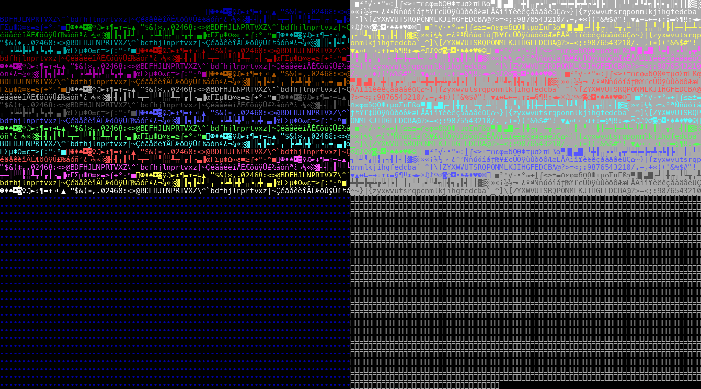

# UBER micro demos

**Ten DOS demos, each under 9 bytes of x86 assembly: the screen painted by the stack, RAM dumped as text, a pulsing cursor, and five that make noise.**

[](https://github.com/djayuffe/uber-micro-demos/actions/workflows/ci.yml)



*Top: STACKMAP, STACKRAIN. Bottom: BULLETS, XRAY. These are the text-mode memory the programs actually
produce, drawn with a stand-in font (they are renders from an emulated CPU, not DOSBox captures).*

None of them sets a video mode, loads a file or allocates memory. They use what DOS hands a `.COM` for
free (`AX = BX = 0`, `SI = 100h`, text mode 3, the BIOS and the PC's hardware) and bend it:

| Demo | Bytes | What it does |
|---|---|---|
| **STACKMAP** | 7 | the **stack is the screen**, and every cell shows its own address: a map of video memory |
| **STACKRAIN** | 8 | the stack is the screen again, and a counter pours down it: a rainbow of every character |
| **BULLETS** | 7 | infinite **recursion** with the stack on the screen: every `CALL` pushes a return address, and the screen fills with blue bullets |
| **XRAY** | 7 | prints the computer's **low memory** (interrupt vectors, BIOS data) as text |
| **BREATH** | 8 | the text **cursor pulses**: its shape changes every timer tick |
| **BUZZ** | 8 | flips the **PC speaker** as fast as the CPU can: a buzz whose pitch is the CPU speed |
| **STATIC** | 6 | **white noise**: the timer's fastest-changing bits drive the speaker |
| **TICKER** | 6 | a **metronome**: the speaker bits step 1, 2, 3, 0 on every 55 ms tick |
| **GEIGER** | 7 | a **Geiger counter**: random clicks, 18 a second |
| **TYPER** | 8 | a **typewriter**: whatever you press is echoed back |

## Run them

Download the `.COM` files from the [latest release](../../releases/latest) and run one in
[DOSBox](https://www.dosbox.com/) (`mount c .`, `c:`, `STACKRAIN.COM`), or build and launch:

```sh
./build.sh                  # NASM: assembles all ten and enforces each size budget
./run-dosbox.sh stackrain   # any of: stackmap stackrain bullets xray breath buzz static ticker geiger typer
```

Needs [NASM](https://www.nasm.us/) (macOS: `brew install nasm`, `brew install --cask dosbox`).

**They never exit** (there is no room for the keyboard check): close DOSBox, or press Ctrl+F9 in it.
**The launcher pins DOSBox to about 3 MIPS** (`cycles=3000` in `DOSBOX.CONF`). These demos have no room for
timing code, so their speed *is* the CPU's speed: at `cycles=max`, STACKRAIN, XRAY, BUZZ and STATIC are an
unreadable blur or an inaudible whine. BREATH, TICKER and GEIGER pace themselves with `HLT`.

## How they work

**The stack as a screen** (STACKMAP, STACKRAIN, BULLETS). Text-mode video memory is at `B800:0000`, and
`push 0B800h` / `pop ss` (4 bytes) puts the stack there. After that every `PUSH` and `CALL` is a write to the
screen, and as `SP` counts down and wraps around the 64 KB segment it walks across the whole text page. No
`ES`, no `STOSW`, no pointer: the CPU's stack pointer is the cursor.

- **STACKMAP**: `push sp` stores the stack pointer, which is also the address being written, so each cell holds
  its own address: the character is the low byte (so each row is a ramp of 80 even codes, starting 160 codes
  higher than the row above, modulo 256) and the colour is the high byte (it steps once every 128 cells,
  down the screen).
- **STACKRAIN**: `inc ax` / `push ax` writes a counter; character = low byte, colour = high byte.
- **BULLETS**: `call` to itself. The return address `0107h` is pushed over and over: character `07h` (a bullet),
  colour `01h` (blue).

**XRAY**: `AX = 0` at entry, so `mov ds,ax` (2 bytes) points `DS` at segment 0, where the interrupt vector table
and the BIOS data area live. `lodsb` / `int 29h` ("DOS fast console output") prints them from offset `0100h` on.
The control bytes (CR, LF, backspace, BEL) do what they always do to the picture.

**BREATH**: BIOS `INT 10h` AH = 1 sets the cursor shape from `CX` (start line, end line); `inc cx` and a `HLT`
(sleep until the next 18.2 Hz tick) animate it.

**The speaker** (BUZZ, STATIC, TICKER, GEIGER). Port `61h` bit 1 is the speaker cone and bit 0 gates timer 2.
BUZZ toggles bit 1 in a tight loop. STATIC and GEIGER write the timer's counter (`in al,40h`, which changes every
0.84 us) straight to port `61h`, so its low bits are a free random number generator: STATIC at full speed, GEIGER
held for one tick between writes. TICKER counts through the bit patterns once per tick.

**TYPER**: BIOS `INT 16h` with `AH = 0` blocks for a key and returns it in `AL`; `INT 29h` prints it.

## Testing

`tests/run_tests.sh` runs every binary in an emulated 16-bit CPU (Unicorn), entered the way DOS enters a
`.COM` (`AX = BX = 0`, `CX = 00FFh`, `SI = 0100h`, `DI = SP = FFFEh`), with the BIOS keyboard, the timer
counter and the speaker port emulated. It checks that each is under 9 bytes and within its budget, never touches
memory outside video memory and its own segment, and then its behaviour: STACKMAP's cells each hold their own
address; STACKRAIN's hold consecutive counter values; BULLETS fills the screen with `0107h`; XRAY prints segment 0
in order from `0100h`; BREATH sets the cursor shape once per tick, counting up; BUZZ flips bit 1 on every write;
STATIC and GEIGER write exactly the counter they just read (all four gate/cone combinations occur, GEIGER once per
tick); TICKER steps the bits once per tick; TYPER echoes the keys it is given. CI runs it on every push; a
`vX.Y.Z` tag publishes a release.

**What the tests cannot tell you**: how the five sound demos *sound*, and how they look on a real VGA. The
emulated CPU checks the port writes, not the audio.

## Related

[uber10-dos-demo](https://github.com/djayuffe/uber10-dos-demo) (a 10-byte ASCII scroller),
[uber128-dos-demo](https://github.com/djayuffe/uber128-dos-demo),
[uber256-rotozoomer](https://github.com/djayuffe/uber256-rotozoomer),
[uber256-dos-intro](https://github.com/djayuffe/uber256-dos-intro) and the big one,
[uber40k-dos-demo](https://github.com/djayuffe/uber40k-dos-demo). The index is
[uber-tiny-demos](https://github.com/djayuffe/uber-tiny-demos).

## License

MIT
